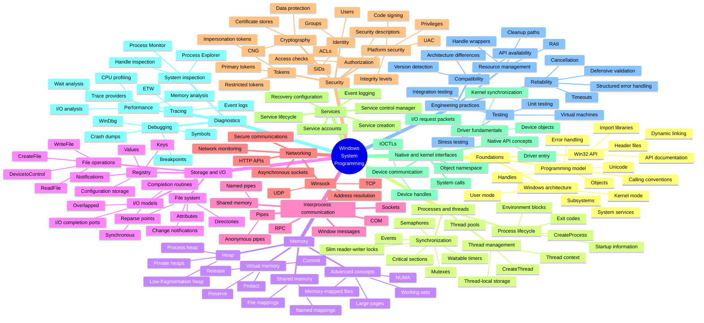

    

        
    

# **`WSPT`** | Windows System Programming Toolkit 

 

    
    &nbsp;
    
    &nbsp;
    
    

## 📖 Contents
- [My Other Awesome Lists](#my-other-awesome-lists)
- [Contributing](#contributing)
- [Contributors](#contributors)

## Windows System Programming Toolkit

| Category | Toolkit / Technology | Aim / Purpose |
|---|---|---|
| SDKs and Frameworks | Windows SDK | Provide Windows headers, libraries, compilers, APIs, samples, and development utilities. |
| SDKs and Frameworks | Windows Driver Kit (WDK) | Develop, build, test, debug, and deploy Windows device drivers. |
| SDKs and Frameworks | Win32 API | Access core Windows functionality, including processes, threads, memory, files, services, security, and networking. |
| SDKs and Frameworks | Native API | Study and access lower-level Windows interfaces used internally by the operating system. |
| SDKs and Frameworks | Windows Runtime (WinRT) | Develop modern Windows applications using language-independent runtime APIs. |
| SDKs and Frameworks | Component Object Model (COM) | Build reusable binary components and support interprocess and cross-language communication. |
| SDKs and Frameworks | .NET | Develop managed applications, services, automation tools, and Windows desktop software. |
| Compilers and Assemblers | Microsoft C/C++ Compiler (MSVC) | Compile and optimize native Windows C and C++ applications. |
| Compilers and Assemblers | Clang/LLVM | Compile, optimize, inspect, and analyze native Windows applications using the LLVM toolchain. |
| Compilers and Assemblers | GCC through MinGW | Build Windows applications using the GNU compiler ecosystem. |
| Compilers and Assemblers | Microsoft Macro Assembler (MASM) | Assemble x86 and x64 assembly programs for Windows. |
| Compilers and Assemblers | Netwide Assembler (NASM) | Assemble portable x86 and x64 assembly source code. |
| Build Tools | MSBuild | Automate the build process for Visual Studio and Microsoft development projects. |
| Build Tools | CMake | Generate portable build configurations for Windows and cross-platform projects. |
| Build Tools | Ninja | Perform fast and incremental software builds. |
| Build Tools | NMake | Build projects using Microsoft-style makefiles. |
| Build Tools | NuGet | Manage .NET and native project dependencies. |
| Build Tools | vcpkg | Install and manage C and C++ libraries for Windows projects. |
| Debugging Tools | WinDbg | Perform advanced user-mode and kernel-mode debugging, crash-dump analysis, and memory inspection. |
| Debugging Tools | Visual Studio Debugger | Debug application source code, threads, exceptions, memory, and native or managed processes. |
| Debugging Tools | CDB | Perform command-line debugging of user-mode Windows applications. |
| Debugging Tools | NTSD | Debug user-mode applications through a console-based debugging interface. |
| Debugging Tools | KD | Debug the Windows kernel, drivers, and kernel-mode failures. |
| Debugging Tools | Application Verifier | Detect memory, handle, heap, locking, and API usage errors during application execution. |
| Debugging Tools | Global Flags (GFlags) | Enable advanced diagnostic, heap, loader, and debugging options. |
| Debugging Tools | Debug Diagnostic Tool | Diagnose crashes, hangs, memory leaks, and performance problems. |
| System Inspection | Process Explorer | Inspect processes, threads, handles, security tokens, loaded modules, and process relationships. |
| System Inspection | Process Monitor | Monitor real-time file, Registry, process, thread, and network-related activity. |
| System Inspection | System Informer | Inspect and manage processes, services, handles, modules, and system resources. |
| System Inspection | Handle | Identify open handles and the processes that own them. |
| System Inspection | ListDLLs | List dynamic-link libraries loaded by running processes. |
| System Inspection | Autoruns | Examine programs, services, drivers, and tasks configured to start automatically. |
| System Inspection | TCPView | Display active TCP and UDP connections and their owning processes. |
| System Inspection | WinObj | Explore the Windows Object Manager namespace and kernel objects. |
| Performance and Tracing | Windows Performance Recorder (WPR) | Record detailed system, CPU, memory, disk, network, and application performance events. |
| Performance and Tracing | Windows Performance Analyzer (WPA) | Analyze performance traces collected from Windows systems. |
| Performance and Tracing | Xperf | Capture and process Event Tracing for Windows performance data. |
| Performance and Tracing | Performance Monitor | Monitor performance counters and system resource utilization. |
| Performance and Tracing | Event Tracing for Windows (ETW) | Collect high-performance diagnostic, application, kernel, and system events. |
| Performance and Tracing | Resource Monitor | Observe real-time CPU, memory, disk, and network usage. |
| Performance and Tracing | PIX | Analyze graphics performance, GPU workloads, and DirectX applications. |
| Binary Inspection | DUMPBIN | Inspect PE headers, imports, exports, symbols, sections, and dependencies. |
| Binary Inspection | Dependencies | Analyze DLL dependencies, imports, exports, and module-loading requirements. |
| Binary Inspection | PE-bear | Examine the internal structure and metadata of Portable Executable files. |
| Binary Inspection | CFF Explorer | Inspect and edit PE structures, headers, directories, imports, and resources. |
| Binary Inspection | Sigcheck | Inspect file versions, digital signatures, hashes, and signing trust information. |
| Binary Inspection | PDB and Symbol Tools | Resolve function names, source locations, stack traces, and debugging symbols. |
| Binary Inspection | Ghidra | Disassemble, decompile, and analyze Windows executable files and libraries. |
| Binary Inspection | IDA | Perform interactive disassembly, control-flow analysis, and binary inspection. |
| Network Analysis | Wireshark | Capture and analyze network packets and communication protocols. |
| Network Analysis | TCPView | Associate active TCP and UDP connections with Windows processes. |
| Network Analysis | netstat | Display network connections, listening ports, interface statistics, and routing information. |
| Network Analysis | Packet Monitor (pktmon) | Capture, inspect, and diagnose Windows network traffic and packet drops. |
| Network Analysis | curl | Test HTTP, HTTPS, and other network protocols from the command line. |
| Network Analysis | PowerShell Networking Cmdlets | Configure, inspect, test, and automate Windows networking operations. |
| Testing and Automation | PowerShell | Automate builds, tests, deployment, configuration, and system validation. |
| Testing and Automation | Python | Create test harnesses, automation scripts, parsers, and development utilities. |
| Testing and Automation | GoogleTest | Write and execute unit tests for native C and C++ applications. |
| Testing and Automation | Catch2 | Create lightweight unit and integration tests for C++ projects. |
| Testing and Automation | Microsoft Native Unit Test Framework | Test native C++ code inside Visual Studio projects. |
| Testing and Automation | Application Verifier | Detect runtime defects involving memory, synchronization, handles, and API contracts. |
| Testing and Automation | Virtual Machines | Create isolated and reproducible environments for development, testing, and debugging. |
| Testing and Automation | CI/CD Pipelines | Automate compilation, testing, quality checks, packaging, and deployment. |
| Documentation and Reference | Windows API Documentation | Provide official descriptions of Windows functions, structures, constants, and programming requirements. |
| Documentation and Reference | Windows Driver Documentation | Explain Windows driver architecture, frameworks, development, deployment, and debugging. |
| Documentation and Reference | Windows Internals | Explain Windows architecture, processes, memory, security, I/O, and kernel mechanisms. |
| Documentation and Reference | SDK Header Files | Provide authoritative API declarations, structures, constants, macros, and type definitions. |
| Documentation and Reference | WDK Samples | Demonstrate recommended driver-development techniques and implementation patterns. |
| Documentation and Reference | Sysinternals Documentation | Explain the operation and practical use of Windows system inspection utilities. |

##

### My Other Awesome Lists
You can access the my other awesome lists [here](https://cyberthreatdefence.com/my_awesome_lists)

### Contributing
[Contributions of any kind welcome, just follow the guidelines](contributing.md)!

### Contributors
[Thanks goes to these contributors](https://github.com/cybersecurity-dev/windows-system-programming-toolkit/graphs/contributors)!

[🔼 Back to top](#wspt--windows-system-programming-toolkit-)
